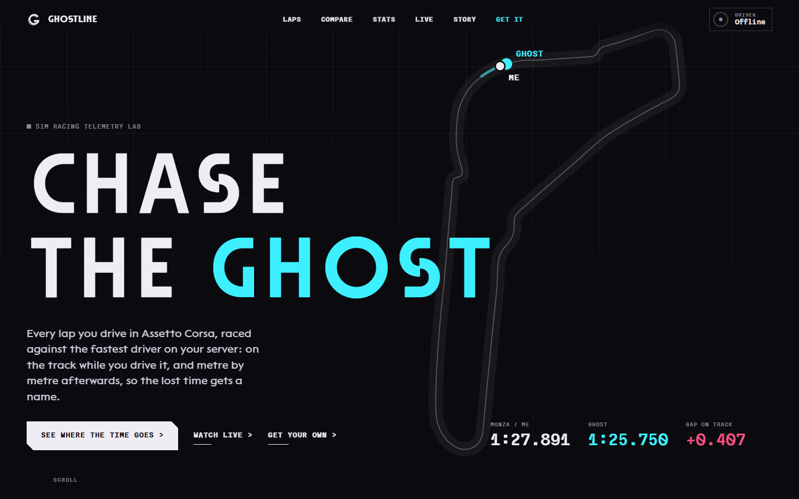
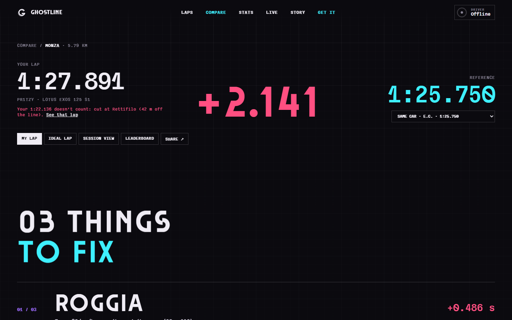
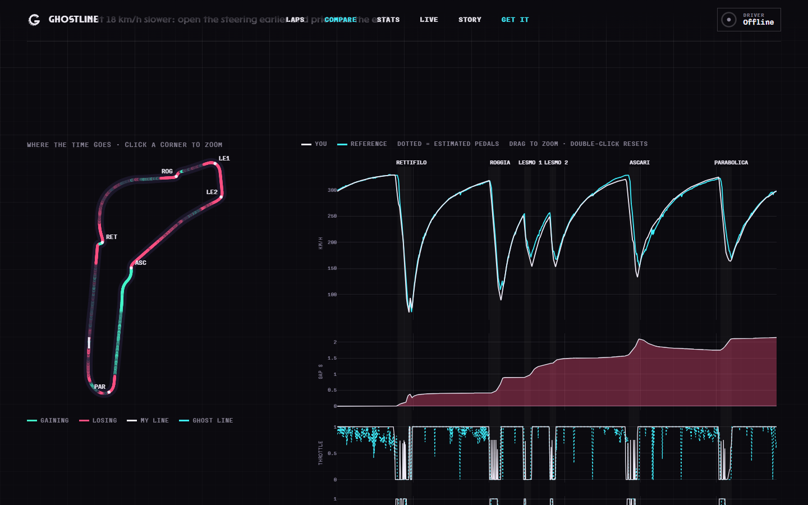
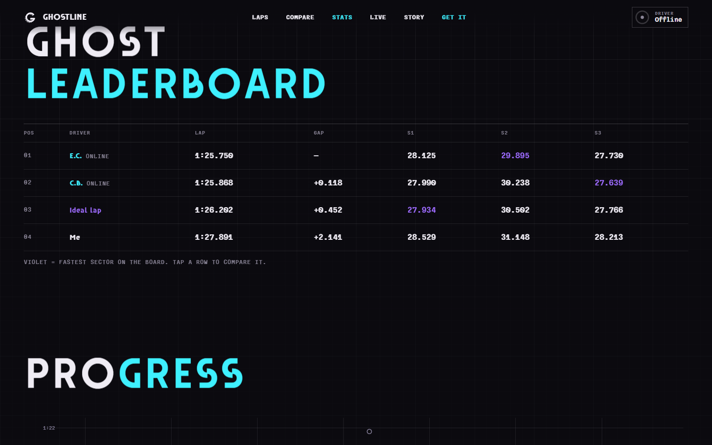

# Ghostline

   

**Find out exactly where you lose time in Assetto Corsa, and fix it while you drive.** Ghostline records every lap,
keeps the fastest drivers on your server as ghosts, coaches you on the track with brake boards, a racing line and a 3D
ghost, and shows you corner by corner afterwards where the time went. Free, open source, and everything stays on your
PC.

**Live demo:** [ghostline.prithvisingh.fyi](https://ghostline.prithvisingh.fyi), a read-only copy with real laps.

## The story

**How it started.** In October 2026 I was lapping a Lotus Exos 125 S1 at Monza online, and a handful of drivers were
always quicker. Telemetry tools record your own laps; nobody hands you theirs. But Assetto Corsa's in-game API sees
every car on the server, so a small in-game app could log the fastest drivers as they drove, keep their laps as
ghosts and line them up against mine, metre by metre.

**What it has become.** Two weeks later:

| Release | What it added |
|---|---|
| **1.0** (Oct 6) | Laps recorded automatically, ghosts of the three fastest drivers per car and track, a corner-by-corner debrief in plain words ("Roggia: brake 14 m later"), a live page for a second monitor, stats. |
| **2.0** (Oct 8) | The in-game side rebuilt around shared memory: about 0.02 ms a frame, 0.001 ms with Custom Shaders Patch. |
| **2.1** (Oct 8) | A real Windows app: an installer with no admin prompt, a tray icon, starts with the game and closes after it. Built, self-tested and checksummed by GitHub from this source. |
| **2.2** (Oct 16) | Coaching inside the game: brake boards with a countdown timed from your speed, and a see-through 3D ghost. |
| **2.3** | One dash that replaces every other app, a racing line like the F1 games' that follows your speed, and every lap checked for a bad recording before it can become a ghost. |

**What's next.** Corner notes in the game while you drive, ghost files to swap laps with friends, real pedal data
for every ghost, a signed installer and an opt-in shared ghost library: see [ROADMAP.md](ROADMAP.md).

## What you get

### On the track (with Custom Shaders Patch)

- **Brake boards** at every corner, where the best lap for your car braked, with a tick-tick-brake countdown timed
  from the speed you're carrying, so you brake on the beat.
- **A racing line** of chevrons along the best lap's line, like the F1 games': green, yellow before a braking zone,
  red where you'd have to brake at your speed. Full lap or corners only.
- **A 3D ghost** of that lap, see-through, with the gap above it. Or the ghost of your own session best.
- **One dash for everything**: standings with live gaps, timing and sectors, gear and revs with the delta, pedals
  with the ghost's inputs, tyres, a track map and race flags, in one horizontal window. Switch any section off.
- Only you see any of it, online too.

### After the session

- **Every lap, recorded automatically.** Speed, throttle, brake, steering, gear and your line, 60 times a second.
  No buttons, no exporting.
- **Ghosts of the fastest drivers.** The in-game app logs every other car on your server (or the AI); the best lap
  of the three fastest drivers is kept for each car and track. Cut laps and laps broken by online lag are thrown out.
- **A debrief that tells you what to fix.** "Lesmo 2: carry 3 km/h more through the apex". Speed, gap and pedal
  charts, and a track map coloured by where you gain and lose.
- **A live page for a second monitor**: gap to your best and to the ghost, predicted lap, sectors, standings,
  tyres, brakes and fuel.
- **Stats**: a ghost leaderboard with sectors, your ideal lap from your best mini-sectors, and progress over time.

| Compare | Where the time goes | Stats |
|---|---|---|
|  |  |  |

Two sample comparisons (Monza and Spa, Lotus Exos 125 S1) are loaded on first start so you can look around before
you drive. They disappear once your own laps start coming in.

### Built to be used

- **Tested on every change.** Seven test suites run on every push, including the in-game apps in LuaJIT against a
  fake game, frame by frame, and the recorder against a fake game running ten times faster than real time.
- **Light.** In tests the in-game logger costs about 0.001 ms a frame and coaching about 0.002 ms; the Ghostline
  window in the game shows the real numbers on your PC.
- **Data you can trust.** Every lap is checked before it's kept: time against speed and distance, holes in the
  recording, lag jumps, cuts. When the checks improve, stored laps are checked again.
- **Small and tidy.** About 50 KB a lap. Old logs, orphaned files and stale images are cleaned up on every start,
  and the log never grows past 1 MB.
- **Private.** No account, no cookies, no analytics. Nothing leaves your PC unless you ask it to.

## Install

You need Windows 10 or 11 and Assetto Corsa from Steam. Content Manager is optional.

1. Download **[GhostlineSetup.exe](https://github.com/pr1tzy/ghostline/releases/latest/download/GhostlineSetup.exe)** (about 25 MB).
2. Run it. It installs just for you, so there's no admin prompt. It asks one thing: whether Ghostline should start
   when you start a session in Assetto Corsa (and close a few minutes after the game). Nothing is ever added to
   Windows startup.
3. Ghostline opens in your browser. Start a session in Assetto Corsa and drive. The first time, restart that session
   once so the game loads Ghostline's in-game app.

**"Windows protected your PC"?** Ghostline isn't code-signed (a certificate costs money every year). Click **More info > Run anyway**. Every release is built by GitHub from this repository's source, and the release
page lists checksums and a build-provenance record so you can check the file is the real one.

Prefer no installer? Each release also has `Ghostline-portable.zip` (unzip, run `Ghostline.exe`), and you can run it
from source: see [docs/advanced.md](docs/advanced.md#run-from-source).

## Using it

- While Ghostline runs, its icon sits by the clock. Click it to open the site; right-click for the menu (start with
  the game on/off, quit).
- Open it any time from the Start Menu to look at your laps without the game.
- The site lives at http://127.0.0.1:8765. Put the **Live** page on a second monitor while you race.
- For ghosts, race online (or against the AI). Ghostline installs its in-game app into AC for you.
- Logger settings (how often cars are sampled, which cars, on/off) are in the Ghostline Logger window in the game if
  you have Custom Shaders Patch, or in a settings file: see [docs/advanced.md](docs/advanced.md#logger-settings).

## FAQ

**Can this get me banned? Is it a cheat?**
No. It doesn't change the game, your car or the server. Your own laps come from the same telemetry that SimHub and
Crew Chief read. Ghosts come from a normal in-game Python app that sees what your game already shows (where each
car is and how fast it's going). Some servers block custom apps; there, your laps still record but ghosts don't.

**Does it work online?**
Yes, that's the main use. Ghosts are logged from whichever server you're on, for the car you're driving.

**Does it send my data anywhere?**
No. Everything stays on your PC (in `%LOCALAPPDATA%\Ghostline`). Nothing is uploaded and there's no account. If you
tick it in the installer, Ghostline asks GitHub once a day whether a newer version exists. See [Privacy](#privacy).

**Does it run in the background all the time?**
No. If you chose "start with the game", it starts when you start a session in Assetto Corsa and closes a few minutes
after you quit the game. Otherwise it only runs when you open it. It never starts with Windows.

**Which cars and tracks work?**
Every official Assetto Corsa car and track, including the DLCs. Mod cars and tracks are skipped, because mod
versions differ between servers, so the comparison wouldn't be fair.

**Will it hurt my FPS?**
No. The in-game app only copies each car's numbers into shared memory (no files, no text) and does nothing while
Ghostline isn't running; everything else runs outside the game. In tests it costs about 0.02 ms per frame, and about
0.001 ms with Custom Shaders Patch, which gets an even lighter Lua version automatically. Coaching adds about
0.002 ms. The Ghostline window in the game shows the real cost on your PC.

**Can my friends see it?**
By default only you can, on your own PC. If you want a public read-only copy, see
[docs/advanced.md](docs/advanced.md#publish-online).

**How do I update?**
Ghostline tells you when a new version is out (tray menu and References page). Download the new installer and run
it; your laps and settings stay where they are.

**How do I uninstall it?**
Windows Settings > Apps > Ghostline > Uninstall. It also removes the in-game apps from Assetto Corsa, and asks
whether to keep your laps for a later reinstall.

## Something not working?

- **Live says "Waiting for AC"**: the game only shares telemetry in a session (on track or in the pits), not in
  the menus.
- **No ghosts**: ghosts are only recorded while Ghostline is running. Open the **References** page, which shows
  whether the in-game app is installed and active. Restart your AC session after the first install. In Content
  Manager, check Settings > Assetto Corsa > Apps and tick RaceLogger.
- **"Mod content: not recorded"**: that car or track isn't official content (see the FAQ).
- **Ghostline won't start**: the log is in `%LOCALAPPDATA%\Ghostline\data\ghostline.log`.

Still stuck? [Open an issue](https://github.com/pr1tzy/ghostline/issues) with the log.

## Privacy

This program will not transfer any information to other networked systems unless specifically requested by the user
or the person installing or operating it. Ghostline only goes online when you ask it to:

- **Update check**, if you tick it in the installer (or on the References page): once a day it asks GitHub for the
  newest release number ([GitHub's privacy statement](https://docs.github.com/site-policy/privacy-policies/github-general-privacy-statement)).
- **Real-world F1 laps**, when you import one: downloaded from [OpenF1](https://openf1.org).
- **Publishing your site**, only if you set up a Cloudflare Tunnel yourself (see docs/advanced.md).

Everything Ghostline records stays on your PC. There's no account, no analytics and no telemetry.

## More

- [CHANGELOG.md](CHANGELOG.md): what changed in each version.
- [docs/advanced.md](docs/advanced.md): settings, renaming corners, running from source, publishing online, the
  security model, building releases, and working on the code.
- [ROADMAP.md](ROADMAP.md): what's planned next.
- License: [MIT](LICENSE). Fonts and libraries: [THIRD_PARTY_NOTICES.md](THIRD_PARTY_NOTICES.md).
- Ghostline is a fan project, not affiliated with or endorsed by Kunos Simulazioni, 505 Games or Formula 1.
